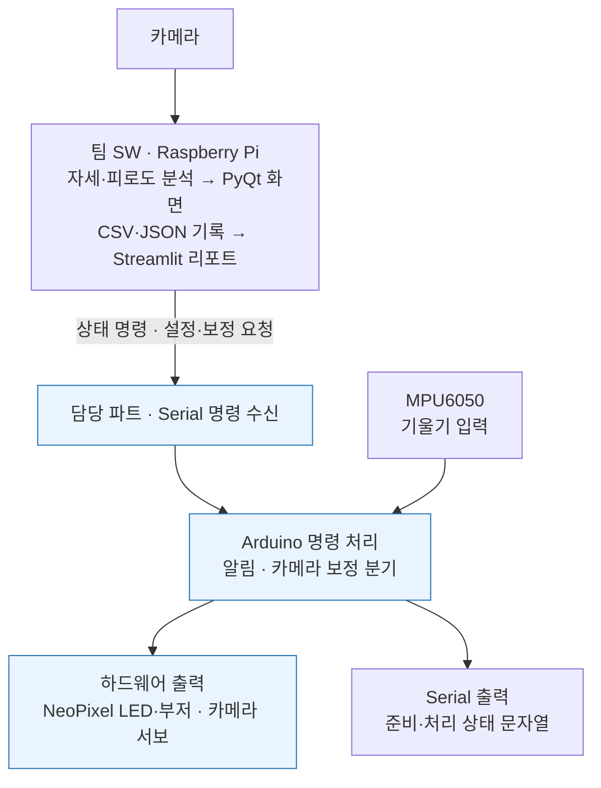
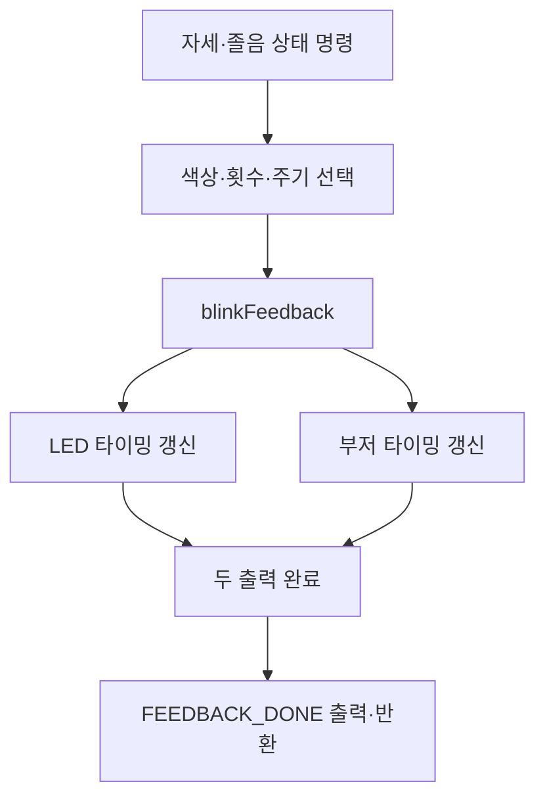
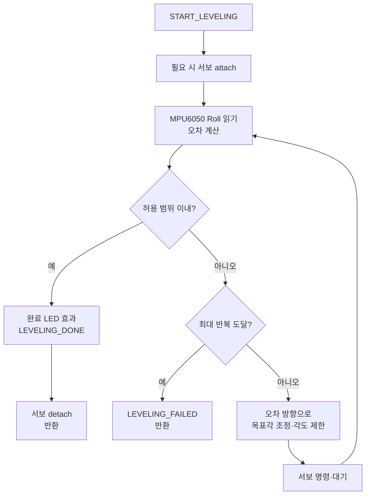

# POCO · Vision Pose Coach

> 자세 분석 결과를 화면·기록과 Arduino 하드웨어 알림으로 연결한 자세 코칭 시스템

## 1. Project Overview

장시간 착석 중에는 자신의 자세 변화를 알아차리기 어렵습니다. POCO는 카메라로 자세·피로도 상태를 분석하고, 화면 피드백과 LED·부저 알림, 일일 리포트로 연결하는 4인 팀 프로젝트입니다.

**초기 개발: 2026.05 · 보고서 개발 일정 기준**

팀 전체는 사용자 기준 자세 설정, 자세·졸음 분류, PyQt 화면, CSV·JSON 기록과 Streamlit 리포트를 구성했습니다. 이 저장소에서는 초기 개발과 Arduino 기반 하드웨어 연동을 다룹니다. 이후 모니터암 고도화는 별도 팀 저장소로 안내합니다.

## 2. My Contribution

**Arduino 펌웨어와 Raspberry Pi–Arduino 통신을 맡아 상위 소프트웨어의 판단을 실제 장치 동작으로 연결했습니다.**

| 담당 영역 | 주요 구현·수정 내용 |
|---|---|
| Arduino 펌웨어·Serial 통신 | 문자열 명령을 받아 설정 변경·알림·카메라 보정으로 분기하고 처리 상태를 출력 |
| LED·부저 알림 | 턱 괴기 알림 LED를 빨강에서 노랑으로 변경하고, StrongAlert 반복 횟수·ON 시간을 수정 |
| IMU 기반 카메라 보정 | MPU6050 기울기를 읽고 목표각과 비교해 서보를 조정하는 펌웨어 담당 |
| 서보 제어 수정 | 보정 성공 후 신호를 해제하고 다음 보정 시작 시 다시 연결하도록 변경 |

### Team POCO

- **조병현**: Pose 모델 구현·튜닝, 자세 데이터 수집
- **신동민**: 리포트 웹·UI 관련 애플리케이션, 데이터 수집
- **이종현**: Face 모델 구현·튜닝, 피로도 데이터 수집
- **최은비**: Arduino 펌웨어·하드웨어 제어·Serial 통신, 카메라 수평 조절·LED·부저 알림, 데이터 수집

모델·UI·리포트는 타 파트 구현이며, 아래에서는 담당 펌웨어와 확인된 수정 내용을 중심으로 설명합니다.

## 3. System Architecture

**팀 전체 구조 · 문서와 코드 기반 요약**

Raspberry Pi가 분석·화면·기록을 처리하고, Arduino는 전달받은 명령에 따라 알림과 카메라 보정을 수행합니다. 강조한 Serial·Arduino 영역이 담당 파트의 중심입니다.

- **팀 소프트웨어:** Python, MediaPipe, TensorFlow/TFLite, PyQt, Streamlit
- **담당 펌웨어:** Arduino C++, Serial, Wire/I2C, Servo, Adafruit MPU6050·NeoPixel

## 4. Key Implementation

### 4.1 Serial 명령을 기능별 처리로 연결

`setup()`에서 Serial을 115200 baud로 설정합니다. `loop()`는 줄바꿈까지 명령을 읽고 공백을 제거한 뒤 알림 설정, 상태 피드백, 수평 보정으로 분기합니다.

| 명령 | 처리 |
|---|---|
| `SET_POSTURE_COUNT:n` / `SET_DROWSY_COUNT:n` | 알림 반복 횟수를 1~10으로 제한해 저장하고 설정 응답 출력 |
| `START_LEVELING` | `autoLevelCameraOnce()` 호출 |
| `Optimal` | 초록 LED 피드백 |
| `Asymmetric` / `ForwardHead` / `ChinPropping` | 상태별 색상과 자세 알림 횟수에 따른 LED·부저 출력 |
| `Drowsy` | 졸음 알림 횟수에 따른 피드백 |
| `StrongAlert` | 강한 경고 패턴 출력 |

준비 시 `ARDUINO_READY`, 설정 반영 시 `POSTURE_COUNT_SET`·`DROWSY_COUNT_SET`, 피드백 종료 시 `FEEDBACK_DONE`을 출력합니다.

### 4.2 상태별 LED·부저 피드백

상태에 따라 색상·반복 횟수·ON/OFF 시간을 `blinkFeedback()`에 전달합니다. 함수는 LED와 부저 각각의 `millis()` 기준 시간을 비교해 출력을 갱신하고, 두 출력이 끝나면 반환합니다.

출력 주기는 따로 관리하며, 함수가 반환된 뒤 다음 Serial 명령을 읽습니다. [d430add](https://github.com/Hyaline-52/POCO-VisionPoseCoach/commit/d430adde9f4b89e33f98c2090e2409fbb87c6b7d)에서는 턱 괴기 알림 LED 색상을 빨강에서 노랑으로 변경했습니다. [397958f](https://github.com/Hyaline-52/POCO-VisionPoseCoach/commit/397958fb3e2b36a389c5b9af17087f45e2f29898)에서는 StrongAlert 반복 횟수를 6회에서 10회로, ON 시간을 200ms에서 100ms로 변경했습니다.

### 4.3 IMU 입력으로 카메라 수평 보정

`getRollAngle()`은 MPU6050 가속도 Y·Z값으로 Roll을 계산합니다. `autoLevelCameraOnce()`는 목표각과의 오차를 비교하고 서보 목표각을 단계적으로 조정합니다. 목표각 제한과 최대 반복 조건으로 조정 범위와 종료 조건을 나눴습니다.

### 관련 코드

핵심 파일은 [`WorkSpace/hardware/raspberrypi_serial_update/raspberrypi_serial_update.ino`](https://github.com/Hyaline-52/POCO-VisionPoseCoach/blob/397958fb3e2b36a389c5b9af17087f45e2f29898/WorkSpace/hardware/raspberrypi_serial_update/raspberrypi_serial_update.ino)입니다.

- `setup()`, `loop()`: 초기화와 명령 분기
- `blinkFeedback()`, `setAllColor()`, `turnOffNeoPixel()`: LED·부저 출력
- `getRollAngle()`, `autoLevelCameraOnce()`: 기울기 계산과 서보 보정

## 5. Troubleshooting

### 카메라 수평 보정 후 서보 떨림 대응

**문제** — 수평 보정 후에도 서보가 미세하게 떨리거나 소리가 나는 현상이 변경 기록과 코드 주석에 남아 있었습니다.

**검토** — 보정 완료 후에도 서보 제어 신호가 유지되는 부분을 수정 대상으로 검토했습니다.

**수정** — `autoLevelCameraOnce()`의 보정 성공 경로에 `cameraServo.detach()`를 추가하고, 다음 보정 시작 시 필요하면 `attach(SERVO_PIN)`하도록 변경했습니다.

**확인 결과** — [개인 수정 커밋](https://github.com/Hyaline-52/POCO-VisionPoseCoach/commit/397958fb3e2b36a389c5b9af17087f45e2f29898)에서 신호 처리 변경을 확인할 수 있습니다. 실제 떨림 감소와 반복 시험 결과는 미확인입니다.

## 6. Results & References

### 구현과 검증 범위

- **구현 근거:** 초기 발표자료의 담당·기능 설명과 코드에서 명령 처리, LED·부저 피드백, IMU·서보 보정 흐름을 확인했습니다. 커밋으로 턱 괴기 알림 LED 색상 변경(d430add), StrongAlert 반복 횟수·ON 시간 변경과 서보 attach/detach 처리 추가(397958f)를 확인했습니다.
- **실기기 검증 한계:** 알림 지연, 보정 오차·성공률, 떨림·소음 감소와 재보정·반복 시험의 비교 가능한 측정 자료는 확보되지 않았습니다. 제어 신호 유지는 측정으로 확정된 근본 원인이 아닙니다.
- **코드 범위:** `detach()`는 보정 성공 경로에 있으며 실패 경로에는 없습니다. 알림 처리 중 새 명령 선점이나 상위 앱의 응답 수신·재시도까지 검증한 것은 아닙니다. 개인 수정 근거는 파일 전체 단독 작성을 뜻하지 않습니다.
- **팀 기능의 한계:** 초기 AI·UI·리포트는 발표자료의 구현 설명·사례 화면 기준입니다. 이후 고도화 보고서는 초기 졸음 판단 성능이 실사용에 충분하지 않았다고 평가합니다. 자세 교정의 장기 효과나 일반화 성능을 확인한 결과는 아닙니다.
- **수치와 실행:** 통신 속도·알림 횟수·대기 시간은 설정값입니다. 실제 개발 브랜치·제출본, 보드 선택·업로드·앱 실행 순서는 확인이 필요하며 재실행 검증은 하지 않았습니다.

### 코드와 기여 기록

- [초기 프로젝트 저장소](https://github.com/Hyaline-52/POCO-VisionPoseCoach)
- [펌웨어 확인 버전 · 397958f](https://github.com/Hyaline-52/POCO-VisionPoseCoach/blob/397958fb3e2b36a389c5b9af17087f45e2f29898/WorkSpace/hardware/raspberrypi_serial_update/raspberrypi_serial_update.ino)
- [턱 괴기 알림 LED 색상 변경(빨강 → 노랑) · d430add](https://github.com/Hyaline-52/POCO-VisionPoseCoach/commit/d430adde9f4b89e33f98c2090e2409fbb87c6b7d)
- [StrongAlert 반복 횟수·ON 시간 변경, 서보 attach/detach 처리 추가 · 397958f](https://github.com/Hyaline-52/POCO-VisionPoseCoach/commit/397958fb3e2b36a389c5b9af17087f45e2f29898)

기능·담당 설명은 초기 결과발표자료 29~35쪽, 개발 일정과 후속 평가는 고도화 개발완료보고서 11·19쪽을 함께 참조했습니다. 링크는 확인한 코드 버전이며 당시 실제 개발 브랜치와 구분합니다.

### 고도화 프로젝트

이후 POCO는 모니터암·센서·상위 애플리케이션 통합으로 확장했습니다. [고도화 팀 저장소](https://github.com/HONEYDEV0310/2026ESWContest_free_POCO)에서 별도로 확인할 수 있습니다. 고도화의 구현과 팀 시험 수치는 이 초기 저장소의 성과에 포함하지 않습니다.
