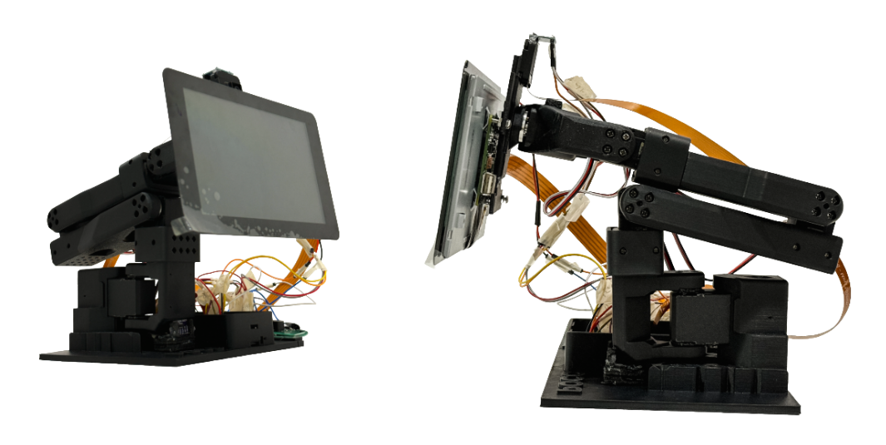
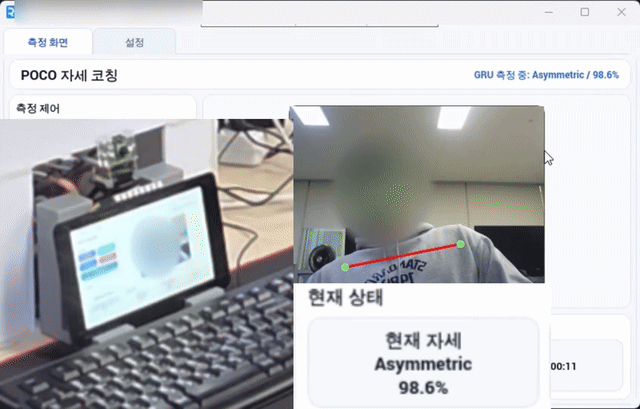
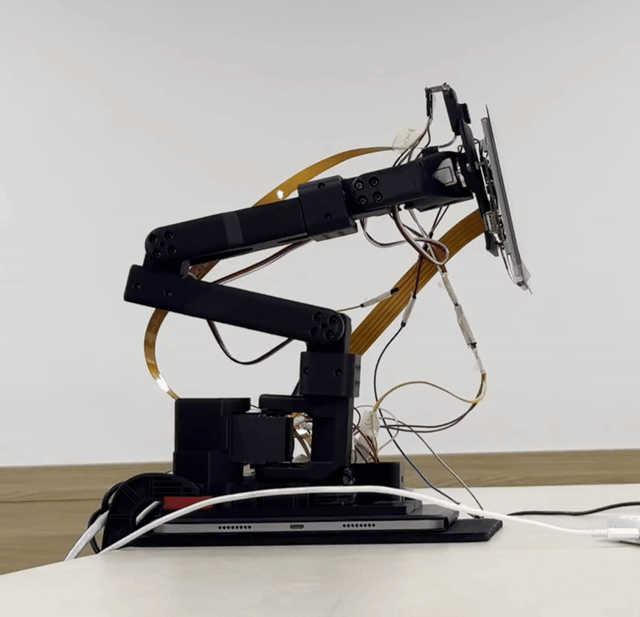
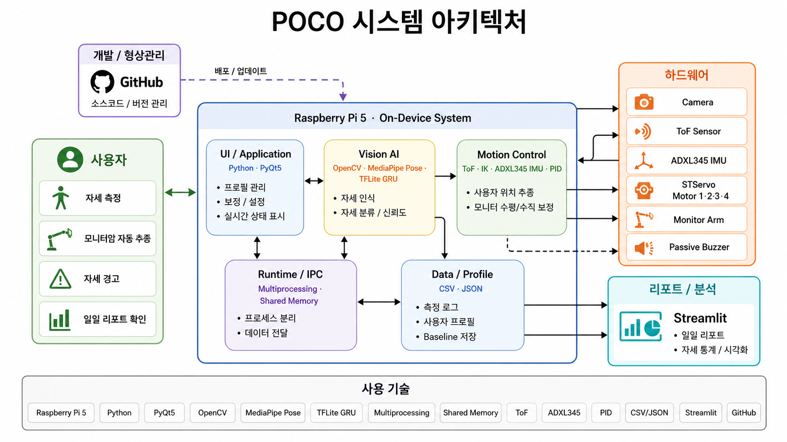
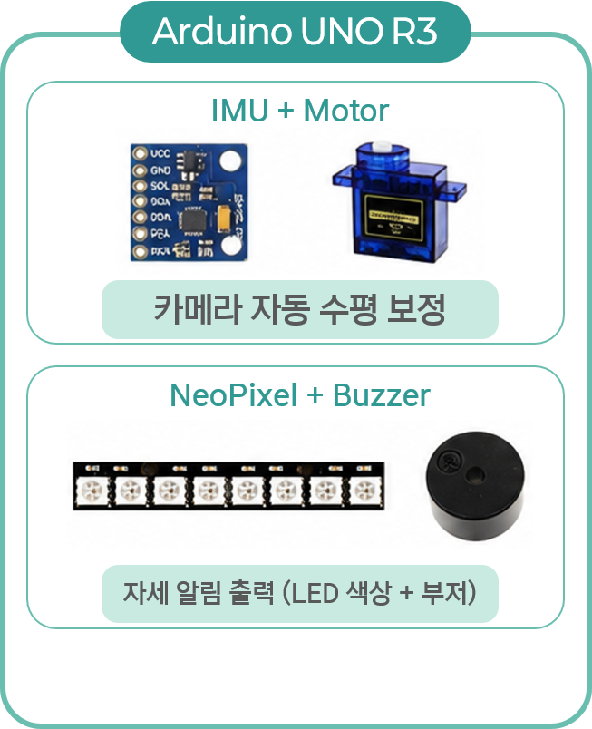
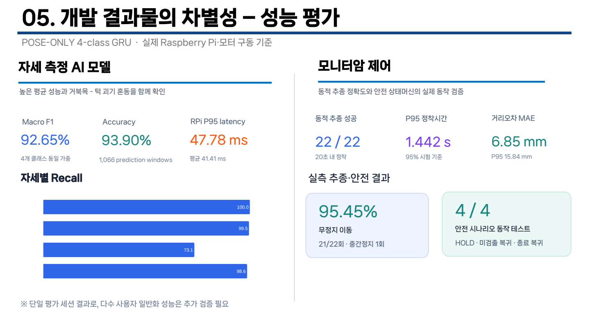

# POCO · AI 자세 코칭 모니터암

사용자의 자세를 분석해 피드백하고, 정상 자세에서 모니터 위치와 수평을 조절하는 온디바이스 AI 시스템입니다. 비전 기반 자세 코칭에서 실제 작업 환경을 조절하는 모니터암으로 확장했습니다.

**🏅 임베디드 소프트웨어 경진대회 결선 진출**

[고도화 팀 프로젝트](https://github.com/HONEYDEV0310/2026ESWContest_free_POCO) · [개인 포트폴리오](https://hyaline-52.github.io/poco.html)

## 프로젝트 개요

| 항목 | 초기 개발 · V1 | 고도화 · V2 |
|---|---|---|
| 기간 | 2026.05 | 2026.08–09 |
| 팀 구성 | 4명 | 4명 |
| 목표 | 자세·졸음 분석과 피드백 | 자세 판단과 모니터암 제어 연결 |
| 주요 기능 | 기준 자세 설정, UI·리포트, LED·부저 알림, 카메라 보정 | 사용자별 보정, 자세 분류, 모니터 위치 추종·수평 유지, 측정 기록 |

**이 저장소에는 초기 개발 코드가 있습니다.** 고도화 코드와 실행 구성은 [고도화 팀 저장소](https://github.com/HONEYDEV0310/2026ESWContest_free_POCO)에서 확인할 수 있습니다.

## 동작 시연

| 자세 상태에 따른 LED 알림 | 모니터암 동작 |
|---|---|
|  |  |

[▶ 전체 시연 영상 보기 · YouTube](https://youtu.be/nm4KHRyxxWM)

## 주요 기능과 시스템 구조

**사용자별 보정 → 자세 판단 → 피드백·환경 조절 → 측정 기록·일일 리포트**

| 기능 | 내용 |
|---|---|
| 자세 판단 | MediaPipe Pose와 TFLite GRU로 정자세·거북목·턱 괴기·비대칭 자세 분류 |
| 사용자별 보정 | 기준 자세·거리·IMU 값 측정 및 프로필 저장·복원 |
| 모니터암 제어 | 정상 자세에서 사용자 위치 추종과 화면 수평 조절, 비정상 자세에서는 추종 제한·경고 |
| 실행 구조 | Raspberry Pi 5에서 UI·Vision AI·Hardware 프로세스를 분리하고 상태·데이터 전달 |
| 기록·리포트 | CSV·JSON 저장과 Streamlit 기반 일일 자세 통계 |

고도화 기본 통합 실행은 **POSE_ONLY**입니다. 졸음 판단은 확장 기능으로 관리합니다.

*고도화 개발완료보고서의 시스템 구조. 기본 실행은 Pose·하드웨어 중심입니다.*

기술 스택과 초기 하드웨어 보기

| 구분 | 기술 |
|---|---|
| AI·Vision | MediaPipe Pose, TensorFlow/TFLite, GRU, OpenCV |
| Application | Python, PyQt5, Streamlit |
| Runtime·Data | Multiprocessing, Shared Memory, CSV, JSON |
| 초기 장치 | Arduino, Serial, MPU6050, 카메라 서보, LED·부저 |
| 고도화 장치·제어 | Raspberry Pi 5, ToF, IMU, Motor1–4, IK |

## 팀 시험 결과

**POSE-ONLY 구성 · 실제 Raspberry Pi·모터 구동 · 동적 추종 22회**

| 항목 | 결과 |
|---|---|
| 20초 내 정착 | 22/22회 |
| 정착시간 P95 | 1.442초 |
| 거리오차 MAE | 6.85mm |
| 무정지 이동 | 21/22회 · 중간정지 1회 |

고도화 개발완료보고서 15쪽의 팀 전체 시스템 시험 결과입니다. 개인 변경만의 개선율을 측정한 결과와 구분합니다.

시험 결과 원본 보기

## 개인 담당

초기 Arduino 펌웨어·Serial 통신·알림·카메라 보정과, 고도화 Motor1·2 제어 연결·조건 처리·하드웨어 통합을 담당했습니다. Motor1·2는 공동 개발했습니다.

[개인 구현·문제 해결·시험 결과 보기 →](https://hyaline-52.github.io/poco.html)

## 코드와 자료

| 자료 | 연결 |
|---|---|
| 초기 코드 | [현재 저장소](https://github.com/Hyaline-52/POCO-VisionPoseCoach) |
| 초기 펌웨어 | [Serial·알림·카메라 보정](https://github.com/Hyaline-52/POCO-VisionPoseCoach/blob/397958fb3e2b36a389c5b9af17087f45e2f29898/WorkSpace/hardware/raspberrypi_serial_update/raspberrypi_serial_update.ino) |
| 고도화 코드·아키텍처 | [팀 저장소](https://github.com/HONEYDEV0310/2026ESWContest_free_POCO) |
| 고도화 상위 원본 | [EmbeddedVisionPoseCoach/POCO](https://github.com/EmbeddedVisionPoseCoach/POCO) |

초기 코드와 고도화 실행 환경은 구분해서 사용합니다. 하드웨어 구성과 보정값은 해당 버전의 자료를 기준으로 확인합니다.
