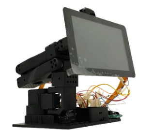
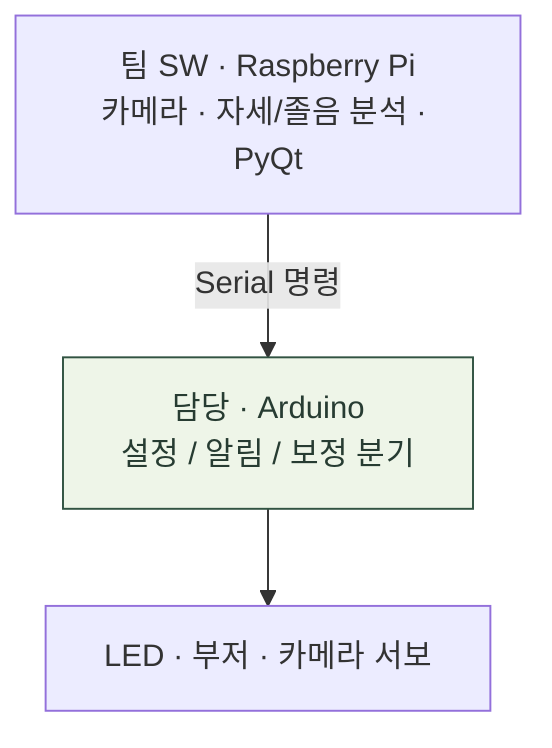
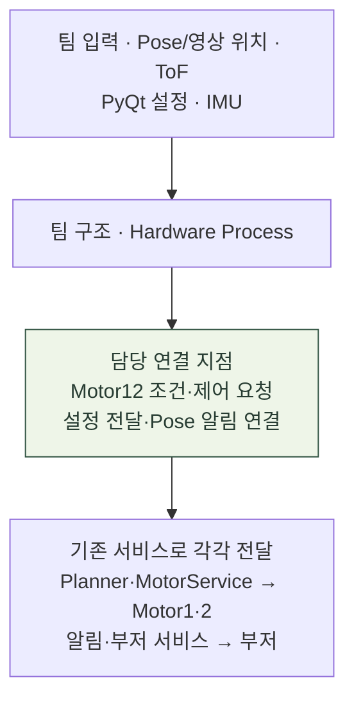
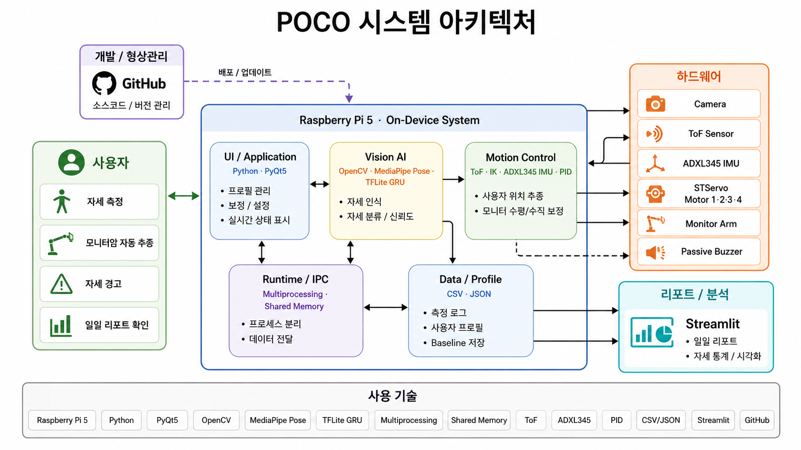
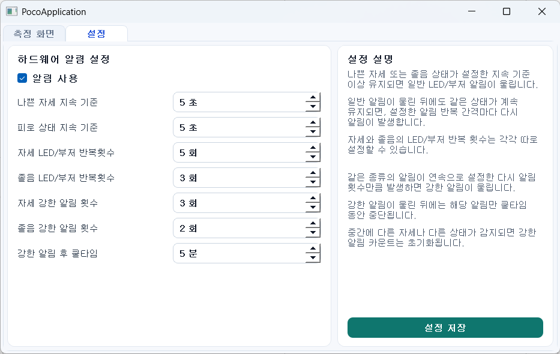
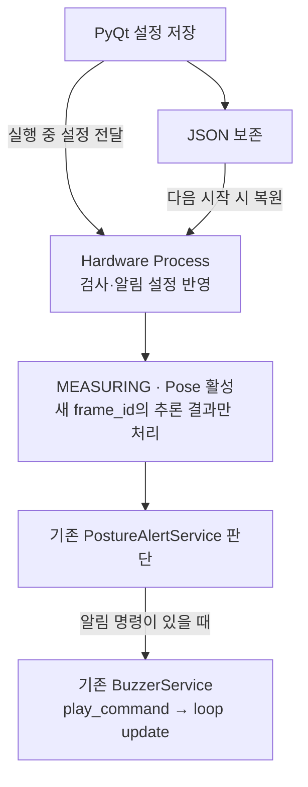

# POCO — 자세 코칭에서 모니터암 제어로

> 자세 분석 결과를 Arduino 알림과 카메라 제어로 전달하고, 모니터암의 위치 추종·하드웨어 통합으로 확장한 4인 팀 프로젝트입니다.

고도화 팀 결과물 · 개발완료보고서 4쪽 / 담당: 모터 제어 연결·캘리브레이션 참여·하드웨어 통합

[초기 코드](https://github.com/Hyaline-52/POCO-VisionPoseCoach) · [고도화 팀 코드](https://github.com/HONEYDEV0310/2026ESWContest_free_POCO) · [웹 포트폴리오](https://hyaline-52.github.io/poco.html)

**이 저장소의 코드는 초기 개발본입니다.** 아래 README는 초기 개발과 고도화에서 수행한 역할을 함께 설명합니다. 고도화 코드는 별도 팀 저장소에 있으며, 해당 코드와 개인 수정 커밋으로 연결합니다.

## 1. Project Overview & Evolution

장시간 착석 중에는 자세 변화를 알아차리기 어렵습니다. 초기 POCO는 자세·졸음 분석을 화면과 장치의 알림으로 전달했습니다. 고도화에서는 사용자 위치와 자세를 모니터암 제어에 연결해 작업환경을 조절하는 방향으로 확장했습니다.

| 구분 | 초기 개발 | 고도화 |
|---|---|---|
| 개발 일정 | 2026.05 | 2026.08 ~ 2026.09 |
| 팀 인원 | 4명 | 4명 |
| 팀 목표 | 자세를 인식하고 피드백 전달 | 위치·자세 입력과 모니터암 연동 |
| 주요 기능 | 기준 자세 설정, 자세·졸음 분류, UI·리포트, 하드웨어 알림·카메라 보정 | 위치 추정, 모니터 위치·수평 제어, 준비·보정·UI 통합 |
| 담당의 중심 | Arduino 펌웨어·Serial·알림·서보 | Motor1·2 연결·조건 처리·설정 및 부저 통합 |

기간은 보고서의 개발 일정이며 실제 완료·발표일과 구분합니다. 고도화 보고서 당시 Face 기능은 비활성화되어 Pose·하드웨어 중심으로 통합했습니다.

**담당 구현에 사용한 기술**

팀 전체에는 MediaPipe·TensorFlow/TFLite·GRU, PyQt·Streamlit, 멀티프로세싱·공유 메모리와 IK 기반 모터 제어가 포함됩니다. 기술 사용과 모듈 전체의 작성 범위는 구분합니다.

## 2. My Contribution

**상위 소프트웨어의 상태·설정을 장치가 처리할 명령으로 연결하고, 동작 조건과 상태를 다뤘습니다.**

### 초기 · Arduino 펌웨어와 하드웨어 제어

- **Serial 명령 처리:** Raspberry Pi에서 받은 문자열을 설정 변경·알림·카메라 보정으로 분기하고 처리 상태를 출력했습니다.
- **LED·부저:** 자세 상태별 피드백을 다루고, 턱 괴기 LED 색상과 StrongAlert 반복·ON 시간을 수정했습니다.
- **카메라 보정:** MPU6050 기울기와 목표각을 비교하는 서보 제어를 담당했습니다. 보정 성공 후 `detach()`, 다음 시작 시 `attach()` 처리를 추가했습니다.

### 고도화 · 기존 제어 모듈의 연결과 통합

- **Motor1·2:** 위치 입력을 기존 제어 경로에 연결하고 입력 유효성·준비 상태·명령 주기·일반 추종 가능 범위를 확인하도록 수정했습니다.
- **설정·알림:** PyQt 설정을 실행 중인 Hardware Process에 전달하고, 시작 시 복원하도록 연결했습니다. 새 Pose 프레임을 기존 알림 판단·부저 서비스에 전달했습니다.
- **캘리브레이션·통합:** 보고서에 모터 제어·캘리브레이션, 하드웨어 설계·코드 통합 담당으로 기록되어 있습니다. 코드에서는 기존 보정 범위를 참조하는 조건 처리와 제어 연결을 확인할 수 있습니다.

### Team POCO · 담당 경계

- **조병현:** Pose 모델·데이터, 고도화 모니터암 앞뒤 제어·모델링 등
- **신동민:** UI·리포트, 고도화 멀티프로세싱·자원 최적화·수평 제어 등
- **이종현:** Face 모델·데이터, 고도화 수평 제어·시뮬레이션 등
- **최은비:** 초기 Arduino·통신·알림·카메라 보정, 고도화 모터 제어·캘리브레이션·통합

Motor12 제어는 공동 작업입니다. **기존 Planner·IK·MotorService, AI 모델, UI 전체, Motor3·4 제어를 개인 단독 구현으로 설명하지 않습니다.** 커밋은 아래 수정의 근거이며 파일 전체의 단독 작성 근거는 아닙니다.

## 3. System Architecture

### 초기 · 판단 결과를 하드웨어 피드백으로

MPU6050의 기울기는 Arduino 보정 입력으로 사용하며, Arduino는 Serial로 준비·처리 상태를 출력합니다. 이 두 보조 경로와 팀의 CSV·JSON 기록·Streamlit 리포트는 위 도식에서 생략했습니다. 도식은 논리적 데이터·제어 흐름이며 물리 배선도가 아닙니다.

### 고도화 · 입력·설정과 기존 제어 모듈 연결

연녹색 영역은 담당 수정 지점입니다. 모터와 부저는 각각의 서비스 경로이며 순차 실행을 뜻하지 않습니다. Hardware Process의 IMU·Motor3·4 수평 제어 경로는 도식에서 생략한 타 파트입니다.

팀 전체 시스템 구조 원본 보기

출처: 고도화 개발완료보고서 5쪽. 팀 전체 구조이며, 모든 모듈의 개인 구현을 뜻하지 않습니다. 보고서 당시 Face 비활성화 상태와 함께 읽어야 합니다.

## 4. Key Implementation

### 4.1 초기 · 명령을 기능별 제어로 변환

[`loop()` · 초기 펌웨어](https://github.com/Hyaline-52/POCO-VisionPoseCoach/blob/397958fb3e2b36a389c5b9af17087f45e2f29898/WorkSpace/hardware/raspberrypi_serial_update/raspberrypi_serial_update.ino)는 줄바꿈까지 명령을 읽고 공백을 제거한 뒤 설정·알림·보정으로 분기합니다. Serial은 115200 baud 설정입니다.

`blinkFeedback()`은 색상·횟수·ON/OFF 시간을 받아 LED와 부저의 타이밍을 `millis()` 기준으로 각각 갱신합니다. **두 출력이 끝나면 반환하며, 다음 Serial 명령은 그 이후에 처리합니다.** 알림 중 새 명령을 선점하는 구조로 설명하지 않습니다.

*초기 결과발표자료 35쪽 · 팀 UI와 담당 Arduino 알림의 연결을 보여줍니다. UI 자체는 타 파트이며, 화면의 시간·횟수는 설정값이지 측정 성능이 아닙니다.*

Serial 명령·상태와 개인 수정 내역

| 입력 | 펌웨어 처리 |
|---|---|
| `SET_POSTURE_COUNT:n` / `SET_DROWSY_COUNT:n` | 반복 횟수 1~10으로 제한 |
| `START_LEVELING` | 카메라 수평 보정 시작 |
| `Optimal` | 정자세 피드백 |
| `Asymmetric` / `ForwardHead` / `ChinPropping` | 자세별 색상·알림 |
| `Drowsy` / `StrongAlert` | 졸음·강한 알림 패턴 |

준비·처리 출력에는 `ARDUINO_READY`, `POSTURE_COUNT_SET`, `DROWSY_COUNT_SET`, `FEEDBACK_DONE` 등이 있습니다. 앱의 ACK·재시도나 통신 오류율까지 검증한 것은 아닙니다.

- [d430add](https://github.com/Hyaline-52/POCO-VisionPoseCoach/commit/d430adde9f4b89e33f98c2090e2409fbb87c6b7d): 턱 괴기 LED **빨강 → 노랑**.
- [397958f](https://github.com/Hyaline-52/POCO-VisionPoseCoach/commit/397958fb3e2b36a389c5b9af17087f45e2f29898): StrongAlert LED·부저 반복 **6 → 10회**, ON 시간 **200 → 100ms**, 서보 attach/detach 추가.

### 4.2 초기 · 기울기 오차로 카메라 서보 조정

`getRollAngle()`은 MPU6050 가속도 Y·Z로 Roll을 계산합니다. `autoLevelCameraOnce()`는 목표각과의 오차를 보고 서보 목표각을 단계적으로 조정하며, 제한각·최대 반복 조건으로 보정 범위와 종료를 관리합니다.

**START_LEVELING → 기울기·오차 계산 → 제한 범위 내 서보 조정 → 완료 또는 실패 상태 출력**

보정 성공 후의 신호 처리는 아래 Troubleshooting에서 구분합니다.

### 4.3 고도화 · Motor1·2 자동 추종 연결과 조건 처리

[`hardware_process.py`](https://github.com/HONEYDEV0310/2026ESWContest_free_POCO/blob/b5e14fd198b9af34b4854b6cb2bd65f516bcf11a/WorkSpace/pyQt/processes/hardware_process.py)에서 위치 입력과 활성 상태를 `context["motor12"]`로 묶어 전달했습니다. [`Motor12Controller.update()`](https://github.com/HONEYDEV0310/2026ESWContest_free_POCO/blob/b5e14fd198b9af34b4854b6cb2bd65f516bcf11a/WorkSpace/pyQt/services/motor12_controller.py)는 이를 읽어 기존 Planner·모터 명령 경로를 호출합니다.

| 단계 | 담당 수정 내용 |
|---|---|
| 입력·준비 확인 | 유효 입력·`user_x_m`·활성화·장치 준비·Planner 존재 검사. 미충족 시 상태 기록 후 반환 |
| 명령 주기 분리 | 상태 계산과 모터 명령 전송 간격을 분리 |
| 일반 추종 범위 확인 | `_normal_tracking_block_reason()`에서 현재 관절각·작업 Z·Recovery 상태 검사 |
| 기존 제어 호출 | Planner에 현재각·위치·보정 범위 전달. 목표가 없으면 DEADBAND, 있으면 기존 이동 경로 호출 |
| 상태 기록 | 목표·속도·처리 결과·보류 사유를 상태로 남김 |

기본 상태 계산 **20Hz**, 명령 **5Hz**는 코드 설정이며 실측 처리 속도가 아닙니다. 명령 주기는 `control.command_hz` 설정을 따릅니다.

현재 보정 안전각을 검사·Planner 입력에 사용하고, 비활성화·종료 시 추종 상태와 Planner 기준을 초기화했습니다. **캘리브레이션 도구나 Recovery 전체를 신규 구현한 것은 아닙니다.** 해당 변경의 Motor12 요청은 `MEASURING`에만 제한되지 않고 유효 위치·준비 상태를 기준으로 하므로, 팀의 정상 자세 추종 정책 전체를 이 커밋의 성과로 귀속하지 않습니다.

근거: [b5e14fd · Motor12 제어 연결](https://github.com/HONEYDEV0310/2026ESWContest_free_POCO/commit/b5e14fd198b9af34b4854b6cb2bd65f516bcf11a)

### 4.4 고도화 · 저장 설정과 새 Pose 프레임을 부저 동작으로

[`on_save_settings_clicked()`](https://github.com/HONEYDEV0310/2026ESWContest_free_POCO/blob/f481ccb0ccf8f60f24c861d0a176db788079d898/WorkSpace/pyQt/mainpyQt.py)에서 기존 JSON 저장을 유지하고 `UPDATE_ALARM_SETTINGS`를 실행 중인 Hardware Process에 전달하도록 연결했습니다. 프로세스가 꺼져 있으면 설정만 저장하며, 다음 시작 시 읽습니다. 설정 저장 때문에 카메라·프로세스를 새로 시작하지 않습니다.

[`run_hardware_process()`](https://github.com/HONEYDEV0310/2026ESWContest_free_POCO/blob/f481ccb0ccf8f60f24c861d0a176db788079d898/WorkSpace/pyQt/processes/hardware_process.py)에서 `frame_id`를 기억해 같은 Pose 결과의 재처리를 막았습니다. 측정 진입 시 추적 상태를 초기화하되 StrongAlert cooldown은 유지하고, 측정 종료 시 추적 상태·대기 부저 명령을 정리합니다.

개인 변경은 기존 알림·부저 서비스의 **연결과 생명주기 처리**입니다. 서비스 전체의 신규 작성이나 알림 지연 개선을 의미하지 않습니다.

근거: [f481ccb · 설정 전달·부저 통합](https://github.com/HONEYDEV0310/2026ESWContest_free_POCO/commit/f481ccb0ccf8f60f24c861d0a176db788079d898)

## 5. Troubleshooting

### 초기 · 카메라 수평 보정 후 서보 떨림 대응

| 과정 | 확인한 내용 |
|---|---|
| 문제 | 보정 완료 후 미세 떨림·소음이 변경 기록과 코드 주석에 남아 있음 |
| 검토 | 보정 후에도 유지되던 서보 제어 신호 처리를 검토 |
| 수정 | 보정 성공 시 `cameraServo.detach()`, 다음 보정 시작 시 필요하면 `attach(SERVO_PIN)` |
| 확인 결과 | 커밋의 코드 변경 확인. **실물 떨림·소음 감소와 반복 보정 효과는 미검증** |

[397958f](https://github.com/Hyaline-52/POCO-VisionPoseCoach/commit/397958fb3e2b36a389c5b9af17087f45e2f29898)의 성공 경로에 detach가 추가되었으며 실패 경로에는 없습니다. 제어 신호 유지가 측정으로 확정된 근본 원인이라고 단정하지 않습니다. 초기 사례를 고도화 성과로 중복 포함하지 않습니다.

## 6. Results & Verification

### 개인 구현 · 코드에서 확인한 범위

초기 명령 처리·알림·서보 신호 수정, 고도화 Motor12 연결·조건 처리 및 설정·Pose·부저 연동을 코드와 개인 커밋으로 확인했습니다. 해당 변경만의 정확도·안정성·지연 개선을 독립 측정한 결과는 아닙니다.

### 고도화 · 팀 전체 실물 시험

**POSE-ONLY 구성 · 실제 Raspberry Pi·모터 구동 · 동적 추종 22회**

| 항목 | 팀 보고서 결과 |
|---|---|
| 20초 내 정착 | **22/22회** |
| 정착시간 P95 | **1.442초** |
| 거리오차 MAE | **6.85mm** |
| 무정지 이동 | **21/22회** · 중간정지 1회 |

출처: 고도화 개발완료보고서 15쪽. 모터 제어·캘리브레이션·통합 담당과 관련된 **팀 결과**이며, 개인 단독 시험이나 특정 커밋만으로 달성한 성과가 아닙니다.

팀 보고서 결과 화면과 검증 한계

보고서 원본 발췌입니다. 왼쪽 AI 모델 지표도 팀 결과이며 개인 AI 성과로 사용하지 않습니다.

- 실물 시험 커밋·브랜치, 목표 거리·부하·정착 허용오차·측정 도구 및 개인별 시험 수행 범위는 확인 필요입니다.
- 확보된 로컬 설정 ToF/Vision 1.0/0.0과 보고서·당시 README의 0.7/0.3이 달라, 실제 시험 적용값은 확정하지 않습니다.
- 보정 도구 전체의 작성 범위와 개인별 배선·설치·보정 시험 범위는 확인 필요입니다.
- 초기 알림 지연·보정 정확도·서보 떨림 감소의 비교 측정 자료는 확보되지 않았습니다.
- Face 비활성화·후속 개선은 당시 보고서 기준입니다. 초기 졸음 판단은 이후 보고서에서 실사용에 충분하지 않았다고 평가했으며, 장기 코칭 효과나 이후 개선 완료를 주장하지 않습니다.

## 7. Code & References

### 코드 위치와 개인 변경

- **초기 코드:** [POCO-VisionPoseCoach](https://github.com/Hyaline-52/POCO-VisionPoseCoach)
  - [펌웨어 · loop / blinkFeedback / getRollAngle / autoLevelCameraOnce](https://github.com/Hyaline-52/POCO-VisionPoseCoach/blob/397958fb3e2b36a389c5b9af17087f45e2f29898/WorkSpace/hardware/raspberrypi_serial_update/raspberrypi_serial_update.ino)
  - [d430add · LED 색상](https://github.com/Hyaline-52/POCO-VisionPoseCoach/commit/d430adde9f4b89e33f98c2090e2409fbb87c6b7d) / [397958f · StrongAlert·서보 신호 처리](https://github.com/Hyaline-52/POCO-VisionPoseCoach/commit/397958fb3e2b36a389c5b9af17087f45e2f29898)
- **고도화 코드:** [보고서 기재 팀 Fork](https://github.com/HONEYDEV0310/2026ESWContest_free_POCO) · [상위 원본 EmbeddedVisionPoseCoach/POCO](https://github.com/EmbeddedVisionPoseCoach/POCO)
  - [Motor12Controller · b5e14fd](https://github.com/HONEYDEV0310/2026ESWContest_free_POCO/blob/b5e14fd198b9af34b4854b6cb2bd65f516bcf11a/WorkSpace/pyQt/services/motor12_controller.py)
  - [Hardware Process 제어 context · b5e14fd](https://github.com/HONEYDEV0310/2026ESWContest_free_POCO/blob/b5e14fd198b9af34b4854b6cb2bd65f516bcf11a/WorkSpace/pyQt/processes/hardware_process.py)
  - [PyQt 설정 저장·전달 · f481ccb](https://github.com/HONEYDEV0310/2026ESWContest_free_POCO/blob/f481ccb0ccf8f60f24c861d0a176db788079d898/WorkSpace/pyQt/mainpyQt.py)
  - [Hardware Process 설정·알림 통합 · f481ccb](https://github.com/HONEYDEV0310/2026ESWContest_free_POCO/blob/f481ccb0ccf8f60f24c861d0a176db788079d898/WorkSpace/pyQt/processes/hardware_process.py)

고정 링크는 구현을 확인한 버전이며 실제 개발 브랜치·실물 시험 제출본과 같다는 뜻은 아닙니다. 고도화 팀 소스는 이 저장소에 복사하지 않습니다.

### 문서·관련 자료

- 초기 결과발표자료: 29~35쪽 — 하드웨어·통신 담당과 알림·카메라 제어.
- 고도화 개발완료보고서: 4~10쪽 — 실물·구조·제어, 11~13쪽 — Face·통합 상태, 15쪽 — 팀 시험, 19쪽 — 일정, 20쪽 — 역할.
- [POCO 웹 포트폴리오](https://hyaline-52.github.io/poco.html)

원본 문서 전체와 영상은 첨부하지 않고 승인된 이미지 발췌만 사용합니다. 실행 환경·보드 업로드·의존성의 재현 검증은 완료되지 않아 범용 실행 절차로 제시하지 않습니다.
